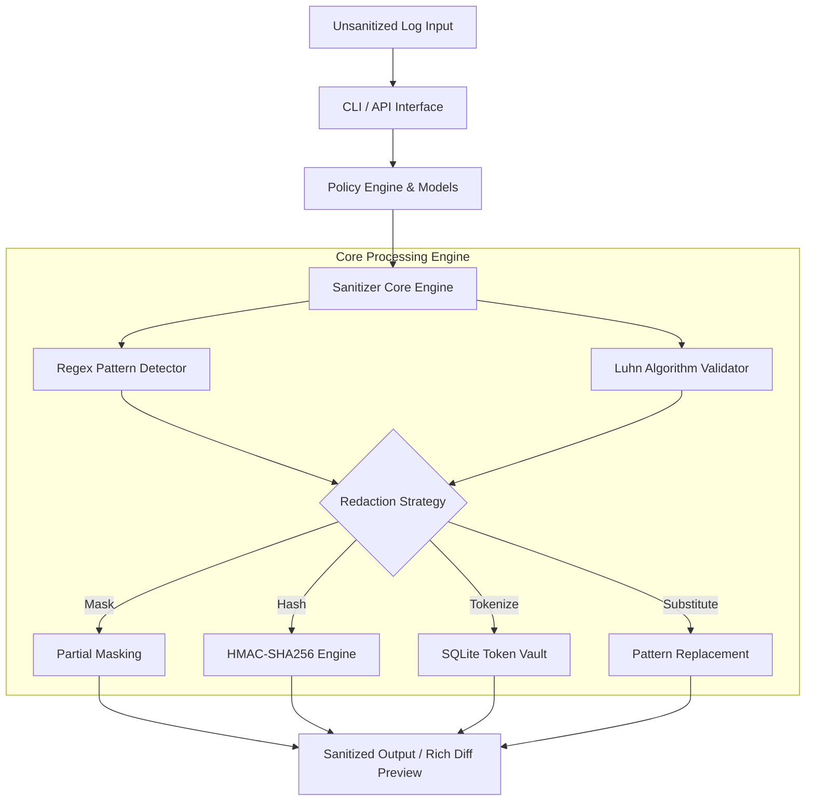

# Log Data Sanitizer 🛡️

[](https://www.python.org/downloads/)
[](https://github.com/your-org/log-data-sanitizer)
[](https://opensource.org/licenses/MIT)
[](https://github.com/psf/black)

> **Empower operational transparency without compromising user privacy.**  
> *Log Data Sanitizer* is an enterprise-grade Python CLI utility and processing library designed to detect, mask, and anonymize Personally Identifiable Information (PII) within application logs, JSON payloads, and unstructured telemetry streams.

---

## 📋 Table of Contents

- [Problem Statement \& Target Audience](#-problem-statement--target-audience)
- [Key Features](#-key-features)
- [Architecture \& System Design](#-architecture--system-design)
- [Technology Stack](#-technology-stack)
- [Installation \& Setup](#-installation--setup)
- [Environment Variables Configuration](#-environment-variables-configuration)
- [Usage Guide](#-usage-guide)
  - [Python API](#python-api)
  - [CLI Command Line Interface](#cli-command-line-interface)
- [Automated Testing](#-automated-testing)
- [Project Structure](#-project-structure)
- [Roadmap](#-roadmap)
- [License](#-license)

---

## 💡 Problem Statement & Target Audience

### The Problem
Engineers frequently need to extract, analyze, or stream production logs into local development environments, third-party APM solutions (e.g., Datadog, Splunk), or external LLM debugging prompts. However, raw application logs often contain sensitive data—such as credit card numbers, auth tokens, IPv4/v6 addresses, and email addresses. Manual search-and-replace scripts:
- Fail to catch obscure edge cases.
- Lack deterministic anonymization capabilities required for correlation across log events.
- Risk severe regulatory non-compliance (GDPR, HIPAA, PCI-DSS).

### Target Audience
* **DevSecOps & Platform Engineers:** Automating compliance pipelines and sanitizing data before external ingestion.
* **Backend Engineers:** Safe local debugging using real production log traces.
* **Data Engineers:** Anonymizing telemetry data pipelines prior to data lake storage.

---

## ✨ Key Features

- **Multi-Pattern PII Detection**: Built-in regex and validation algorithms for emails, API tokens (JWT, Bearer, API Keys), IPv4/IPv6 addresses, and credit card numbers (verified via the **Luhn algorithm**).
- **Flexible Redaction Strategies**:
  - **Partial Masking**: Obfuscate sensitive parts (e.g., `user****@domain.com` or `****-****-****-1234`).
  - **Deterministic HMAC Hashing**: Anonymize identifiers with keyed HMAC-SHA256 hashes to retain correlation ability across log files without exposing raw values.
  - **Vault-Backed Tokenization**: High-performance SQLite-backed token mapping for bidirectional lookup where required.
  - **Pattern Substitution**: Replace tokens with standard descriptors (e.g., `<REDACTED_EMAIL>`).
- **Rich-Powered CLI Utility**:
  - Live Unix `stdin`/`stdout` piping capabilities.
  - Batch file sanitization with configurable concurrency.
  - Interactive, side-by-side Rich terminal diff previews showing real-time redactor operations.
- **Pydantic-Driven Configuration**: Strong type enforcement for policy files, rule exclusion paths, and custom regular expression patterns.

---

## 🏗️ Architecture & System Design

The project uses a modular pipeline architecture separating domain validation, detection logic, data storage, and presentation layers.



### Module Responsibilities

* **`src/models.py`**: Declares Pydantic schemas for data definitions, detector matching rules, redaction policy configurations, and SQLite mapping models.
* **`src/core.py`**: Executes regex matching, Luhn checksum validation, transformation routines (HMAC, substitution, partial masking), and maintains SQLite persistent token vaults.
* **`src/api.py`**: Provides programmatic Python library abstractions (`sanitize_string`, `sanitize_file`, `sanitize_stream`).
* **`src/cli.py`**: Houses the Typer CLI app logic, standard output stream controls, and Rich diff rendering logic.
* **`src/main.py`**: Serves as the main executable entry point dispatching commands to the CLI module.

---

## 🛠️ Technology Stack

| Component | Technology | Description |
| :--- | :--- | :--- |
| **Language** | Python 3.10+ | Core language features and type hinting |
| **CLI Framework** | Typer | Fast, intuitive command-line interface generation |
| **Data Validation** | Pydantic v2 | Data parsing, policy validation, and schema definitions |
| **Terminal UI** | Rich | Rich text formatting, progress bars, and side-by-side diff views |
| **Storage Engine** | SQLite3 | Embedded persistence for deterministic tokenization mappings |
| **Testing** | Pytest | Automated unit and integration testing suite |

---

## 📦 Installation & Setup

### Prerequisites
- Python `3.10` or higher installed on your system.

### 1. Clone the Repository
```bash
git clone https://github.com/your-org/log-data-sanitizer.git
cd log-data-sanitizer
```

### 2. Set Up Virtual Environment
```bash
# Create virtual environment
python3 -m venv venv

# Activate on Linux/macOS:
source venv/bin/activate

# Activate on Windows:
# venv\Scripts\activate
```

### 3. Install Dependencies
```bash
pip install --upgrade pip
pip install -r requirements.txt
```

---

## ⚙️ Environment Variables Configuration

Create a `.env` file in the project root directory by copying `.env.example`:

```bash
cp .env.example .env
```

### Environment Settings Reference

```env
# Secret key used for deterministic HMAC-SHA256 hashing strategy
HMAC_SECRET_KEY=c3a8f921d7e44b80b0811e5f492211aa

# SQLite database location for tokenization mapping vault
TOKEN_DB_PATH=./data/tokens.db

# Default Redaction Strategy: PARTIAL, HMAC, TOKENIZE, or SUBSTITUTE
DEFAULT_REDACTION_STRATEGY=PARTIAL

# Logging verbosity level (DEBUG, INFO, WARNING, ERROR)
LOG_LEVEL=INFO
```

---

## 🚀 Usage Guide

### Python API

Integrate `log-data-sanitizer` directly into your application services or pipelines:

```python
from src.api import SanitizerAPI
from src.models import SanitizerConfig, RedactionStrategy

# Initialize sanitizer instance with HMAC strategy
config = SanitizerConfig(
    default_strategy=RedactionStrategy.HMAC,
    hmac_secret="your-custom-secret-key"
)
sanitizer = SanitizerAPI(config=config)

# 1. Sanitize raw text string
raw_log = "User contact email is john.doe@example.com, IP address: 192.168.1.45"
sanitized_log = sanitizer.sanitize_text(raw_log)

print(sanitized_log)
# Output: User contact email is [HMAC:a8f2...], IP address: [HMAC:7c2e...]

# 2. Batch file processing
sanitizer.sanitize_file(
    input_path="logs/production_app.log",
    output_path="logs/sanitized_app.log"
)
```

---

### CLI Command Line Interface

The package exposes a Typer-powered CLI interface via `src/main.py`.

#### 1. Piping via standard input (`stdin`)
Pipe logs directly from continuous streams or utility outputs:

```bash
cat server.log | python -m src.main pipe
```

#### 2. Processing files in batch
Sanitize an input file and write the scrubbed output to a new file:

```bash
python -m src.main batch --input-file ./logs/app.log --output-file ./logs/app_clean.log --strategy HMAC
```

#### 3. Interactive Diff Preview
Inspect detected PII and inspect side-by-side diff previews before saving changes:

```bash
python -m src.main diff --file ./logs/sample_debug.log
```

---

## 🧪 Automated Testing

The repository features comprehensive unit and integration test coverage using `pytest`.

### Run All Tests
```bash
pytest
```

### Run Tests with Verbose Output & Coverage Report
```bash
pytest -v --cov=src --cov-report=term-missing
```

### Run Specific Test Modules
```bash
# Test Core Detection & Redaction Logic
pytest tests/test_core.py

# Test High-Level API Interfaces
pytest tests/test_api.py
```

---

## 📁 Project Structure

```text
log-data-sanitizer/
├── .env.example            # Environment variable template
├── .gitignore              # Git ignore configuration
├── requirements.txt        # Production & development dependencies
├── src/
│   ├── __init__.py         # Package entry point and metadata
│   ├── api.py              # High-level Python API for strings, files, & streams
│   ├── cli.py              # Typer CLI application implementation
│   ├── core.py             # Detection engine, Luhn validator & strategy processors
│   ├── main.py             # CLI entry point dispatcher
│   └── models.py           # Pydantic schemas and domain data models
└── tests/
    ├── __init__.py         # Test package initializer
    ├── test_api.py         # Unit tests for high-level API
    └── test_core.py        # Unit tests for core detection and sanitization logic
```

---

## 🛣️ Roadmap / Future Enhancements

- [ ] **Presidio & SpaCy Integration**: Incorporate Named Entity Recognition (NER) models for dynamic contextual PII detection (e.g., person names, physical addresses).
- [ ] **Streaming Middleware Plugins**: Native collectors and plugins for Kafka, Fluentd, and Logstash streams.
- [ ] **YAML Policy Auto-Reloading**: Real-time hot-reloading for enterprise policy configurations without process restart.
- [ ] **Performance Optimizations**: C-extensions / Rust bindings for ultra-high throughput log scrubbing environments (>100MB/sec).

---

## 📄 License

Distributed under the MIT License. See [`LICENSE`](LICENSE) for more information.

---

<p align="center">
  <i>Developed for secure engineering workflows by the Daily Project Factory team.</i>
</p>